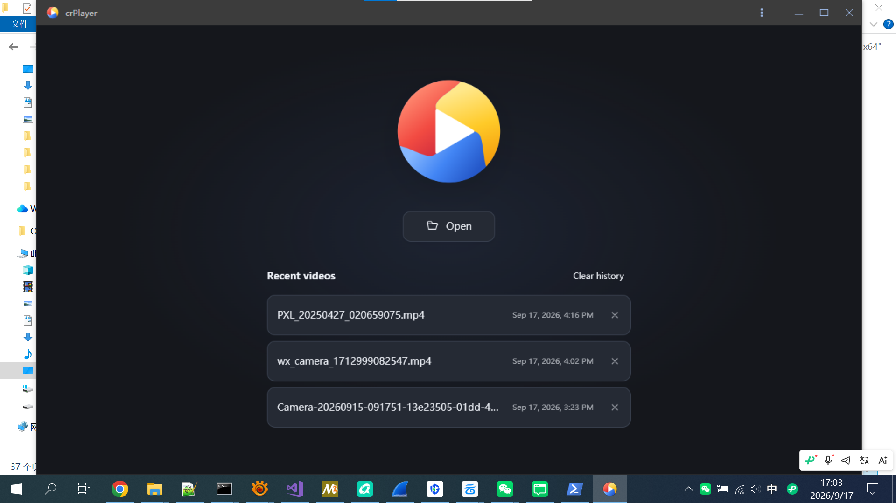
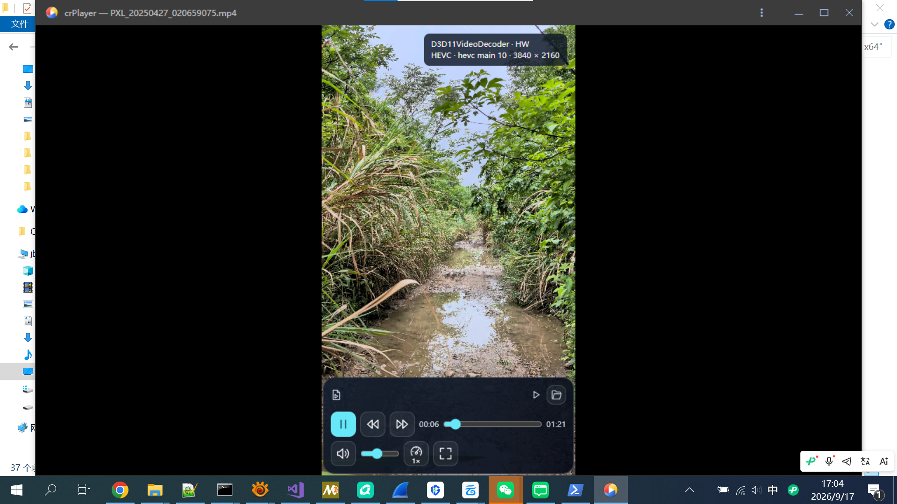
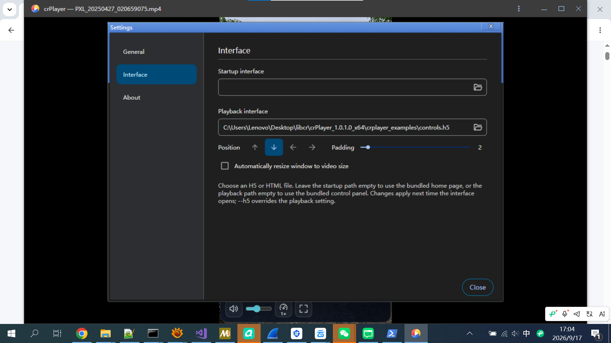

# crPlayer

A free desktop video and image viewer with an HTML5-customizable interface, built on Chromium v150.

Video is decoded and displayed by the native player; images are decoded by Blink and displayed in a native view. A transparent Blink WebView renders the HTML interface over the media, and a small JavaScript API connects the two. The HTML page does not need a `<video>` or `` element.

## Screenshots

Home page with recent media:



Video playback with the HTML control panel and decoder information:



Interface settings for startup and playback pages, panel position, and padding:



## Getting started

Extract the complete release package and keep its runtime files and directories together.

```powershell
# Windows: open the home page.
.\crPlayer.exe

# Play a video with the default control panel.
.\crPlayer.exe "C:\Videos\example.mp4"

# View an image with the default control panel.
.\crPlayer.exe "C:\Pictures\example.png"

# Use a custom HTML interface for playback.
.\crPlayer.exe "C:\Videos\example.mp4" --h5 ".\my-controls.h5"
```

```bash
# Linux
./crPlayer
./crPlayer ./example.mp4
./crPlayer ./example.png
./crPlayer ./example.mp4 --h5 ./my-controls.h5
```

`--h5=./my-controls.h5` is also supported. The `--h5` option requires a media-file argument. Quote paths containing spaces. Codec support depends on the build and available decoders; an MP4 extension alone does not determine compatibility.

The package includes:

| File | Purpose |
| --- | --- |
| `crplayer_examples/startup.h5` | Home page with Open and recent media. |
| `crplayer_examples/controls.h5` | Default video and image controls, including playback, image navigation, zoom, fullscreen, and opening another file. |
| `crplayer_examples/minimal.h5` | A smaller interface example. |

These are ordinary files shipped beside the executable, not HTML compiled into the executable. Keep `crplayer_examples` with the application when moving or upgrading it.

## Choosing an interface

Settings → Interface provides separate startup and playback paths.

- An empty startup path selects the bundled `startup.h5`.
- An empty or unset playback path selects the bundled `controls.h5`.
- A configured custom path overrides the bundled page.
- An explicit `--h5` overrides the playback setting for that session.

Changes apply the next time the corresponding interface opens. Selecting the current package's default page stores the default selection rather than a fixed version-directory path.

If a configured page cannot be read, the loader attempts the corresponding page in the current package. An explicit `--h5` does not use this fallback. If playback interface loading ultimately fails, the application displays “Unable to load the control panel file.” Startup page failures have a separate message. Check the exact path in `debug.log` when diagnosing a failure, especially after moving or upgrading the package.

H5 files are read asynchronously after the window is shown, with a limit of 4 MiB per file. `.h5` means plain UTF-8 HTML here, not an archive or HDF5 file.

## Viewing images

Open images from the command line, the native file picker, or recent files. Supported extensions are `.jpg`, `.jpeg`, `.jfif`, `.png`, `.webp`, `.gif`, `.apng`, `.bmp`, `.ico`, `.avif`, and `.svg`. AVIF requires a build with the corresponding Blink decoder. Animated GIF, APNG, WebP, and AVIF show only their first frame; ICO uses its largest image. HEIC, TIFF, RAW files, and animation playback are not supported.

Images initially fit the window. Use the mouse wheel to zoom around the pointer, drag with the left mouse button to pan, or double-click the image area to switch between Fit to window and Actual size. The control panel also has Fit to window and Actual size buttons; `0` and `1` are their shortcuts. Actual size maps one image pixel to one physical display pixel. Transparent areas use a checkerboard background.

The Previous image and Next image buttons, or the left and right arrow keys, open neighboring supported images in the same directory. Files are sorted by name without descending into subdirectories. Navigation stops at the first and last image. The control panel follows the visible image width; changing images with the keyboard does not reopen a hidden panel. Moving the pointer, clicking the control area, or using Tab can reveal it again. Image mode hides video-only controls and decoder information while keeping Open and Fullscreen. Images share the recent-file list with videos but do not save playback progress.

Image data is read in the background. The previous image remains visible until its replacement has decoded; a failed image shows an error while leaving the previous frame in place. SVG is rasterized with Blink's SVG decoder and refreshed after zooming settles. Bitmap input is limited to 32 MiB, SVG input to 4 MiB; very large dimensions are rejected before decoding. Large or complex images can still briefly occupy the UI thread during decoding.

Settings → Interface can position the bundled panel at the top, bottom, left, or right with 0–36 CSS pixels of padding. It also offers automatic window sizing, off by default. When enabled, opening a video or image sizes a normal window to the media while keeping it within the available display area; fullscreen and maximized windows are left alone. Settings → General can show a native video decoder badge, off by default, with the selected decoder and resolution; this badge is hidden for images.

## Writing an H5 page

Use a self-contained HTML fragment with inline CSS and JavaScript. crPlayer wraps it in a document, installs its bridge before your scripts, and loads it as a static `about:blank` document. Relative paths are not resolved against the H5 file's directory. The following minimal example provides video playback controls; image controls need the image API described below.

```html
<style>
  body { margin: 0; background: transparent; color: white; }
  .controls {
    position: fixed;
    bottom: 22px;
    left: 50%;
    transform: translateX(-50%);
    padding: 12px;
    border-radius: 12px;
    background: rgb(20 20 20 / 85%);
  }
</style>
<div class="controls">
  <button id="open">Open</button>
  <button id="toggle" disabled>Play</button>
  <button id="fullscreen">Fullscreen</button>
  <span id="time">0.0 / 0.0</span>
  <span id="error" role="status"></span>
</div>
<script>
  const player = window.crPlayer;
  const toggle = document.getElementById('toggle');

  // Call gesture-protected methods directly from real user interactions.
  document.getElementById('open').onclick = () => player.open();
  toggle.onclick = () => player.toggle();
  document.getElementById('fullscreen').onclick = () =>
    player.setFullscreen(!player.state.fullscreen);

  function render(state) {
    toggle.disabled = !state.ready || state.mediaType === 'image';
    toggle.textContent = state.paused ? 'Play' : 'Pause';
    document.getElementById('time').textContent =
      `${state.currentTime.toFixed(1)} / ${state.duration.toFixed(1)}`;
    document.getElementById('error').textContent = state.error || '';
    document.documentElement.style.colorScheme = state.dark ? 'dark' : 'light';
  }

  player.addEventListener('statechange', event => render(event.detail));
  render(player.state);
</script>
```

For video, the WebView covers the video rectangle and follows its aspect ratio; letterbox areas are outside the page. For images, it covers the full client area so pointer coordinates match the native image view. Opaque page backgrounds cover the media; use transparent backgrounds where it should remain visible. The overlay receives input; there is no automatic per-element click-through to native views underneath it. A custom H5 page must implement image gestures and controls itself if it needs them.

Inline CSS animations and JavaScript are supported. For overlays synchronized to playback, derive the visual state from `currentTime`, `paused`, and `seeking`. Independent CSS animations do not automatically pause or seek with the video. State updates are not frame-accurate.

The native WebView entrance effect lasts 320 ms and scales from 92% to 100% while fading in. It respects the system's reduced-motion preference. This is separate from animations implemented inside the H5 page. When consecutive files use the unchanged bundled control panel, or another file with identical content, the WebView is reused and does not replay its entrance effect. Each successfully opened file still increments `mediaGeneration`; commands issued for an older file are ignored.

## JavaScript API

Use `window.crPlayer`. Commands are serialized as JSON, checked by a native V8 callback, and posted to the UI thread. Native state is delivered back to JavaScript through the bridge. There is no local HTTP server, network port, or WebSocket involved.

Methods return no completion Promise or command result. Read `player.state` and subscribe to `statechange` to observe changes; do not assume a command has completed when the method returns. Invalid or unauthorized commands can be ignored without an error event. Names beginning with `__crPlayer` are internal implementation details.

| Method | Behavior | Requires user activation |
| --- | --- | --- |
| `open()` | Opens the native file picker. Canceling preserves the current page or media. | Yes |
| `openRecent(id)` | Opens a media file identified by a native history ID, not a file path. | Yes |
| `removeRecent(id)` | Removes one history entry; does not delete the file. | Yes |
| `clearRecent()` | Clears history; does not delete files. | Yes |
| `play()` | Plays; restarts from the beginning after playback has ended. | No |
| `pause()` | Pauses playback. | No |
| `toggle()` | Toggles play/pause. | No |
| `seek(seconds)` | Seeks to a finite time, clamped to `0…duration`. Pending seeks are coalesced. | No |
| `imagePrevious()` / `imageNext()` | Opens the previous or next supported image in the current directory, when available. | Yes |
| `imageFit()` | Fits the current image to the window and centers it. | No |
| `imageActualSize()` | Shows the image at one image pixel per physical display pixel and centers it. | No |
| `imageZoom(factor, x, y)` | Multiplies image zoom around `(x, y)` in client-area CSS pixels. | No |
| `imageWheel(delta, x, y)` | Applies the default low-sensitivity wheel zoom around `(x, y)`; positive `delta` zooms in. | No |
| `imagePan(dx, dy)` | Pans by CSS pixels, constrained to the image bounds. | No |
| `setVolume(value)` | Sets a finite volume, clamped to `0…1`; does not unmute. | No |
| `setMuted(value)` | Sets mute state; the JS wrapper converts the value to Boolean. | No |
| `setPlaybackRate(value)` | Sets a finite rate, clamped to `0.25…4`. | No |
| `setFullscreen(true)` | Enters fullscreen. | Yes |
| `setFullscreen(false)` | Exits fullscreen. | No |
| `addEventListener('statechange', listener)` | Subscribes to state snapshots in `event.detail`. | No |
| `removeEventListener('statechange', listener)` | Removes a subscription. | No |

Play, pause, toggle, and seek require ready video; image zoom and pan methods require a ready image. Volume and mute persist across launches. Avoid sending commands on every state update unless a change is needed; that can create feedback loops.

### State snapshots

`player.state` is replaced on each update. Its top-level object is frozen; nested values such as the history array are not deeply frozen. Treat all fields as read-only. Modifying JavaScript objects does not modify native player state.

| Field | Type / meaning |
| --- | --- |
| `ready` | Boolean: the video pipeline or current image is ready. |
| `mediaType` | `video` or `image`. |
| `mediaGeneration` | Number that changes when a file is successfully opened; bridge commands carry it so stale commands can be ignored. |
| `paused`, `ended`, `seeking`, `buffering` | Boolean playback status flags. |
| `currentTime`, `duration` | Numbers in seconds. |
| `volume` | Number from 0 to 1. |
| `muted` | Boolean. |
| `playbackRate` | Playback speed multiplier. |
| `fullscreen` | Boolean: native window fullscreen state. |
| `error` | Localized error text, or an empty string. |
| `locale` | Application locale, such as `en-US` or `zh-CN`. |
| `fileName` | Media basename; not its complete path. |
| `dark` | Boolean indicating the current dark theme. |
| `recent` | Array of `{id, fileName, openedAt, mediaType}`; `openedAt` is Unix time in milliseconds. |
| `imageZoom`, `imageFit` | Physical-pixel zoom multiplier and whether the image is fitted to the window. |
| `imageWidth`, `imageHeight` | Oriented bitmap dimensions or SVG logical dimensions. |
| `imagePreviousAvailable`, `imageNextAvailable` | Whether a neighboring supported image can be opened. |
| `imageLeft`, `imageDisplayWidth` | Visible image bounds in client-area CSS pixels, used to align the bundled panel. |
| `imageRetainingFrame` | The previous image remains visible while the current image loads. |
| `panelPosition` | `top`, `bottom`, `left`, or `right`. |
| `panelPadding` | Integer from 0 to 36, used as CSS pixels by the bundled panel. |
| `panelPreview` | Boolean: keep the panel visible while Interface settings are being previewed. |

The initial bridge snapshot is minimal. Fields such as `recent`, `mediaType`, `dark`, and panel preferences may be absent until the first native update; use defaults when rendering them. Playback time normally updates approximately every 200 ms, with additional notifications for other changes. Pending native state publications are coalesced, so `statechange` is not a confirmation for every intermediate state or command.

Custom pages must implement their own layout and visibility behavior using the panel fields. The native setting does not automatically reposition arbitrary HTML. The bundled panel supports all four positions, defaults to bottom with 22 px padding, and stays visible during settings preview.

## Windows MSIX package

The MSIX manifest offers crPlayer in Windows Open with/default-app selection for `.mp4`, `.mkv`, `.webm`, `.mov`, `.avi`, and `.m4v` videos, plus `.jpg`, `.jpeg`, `.jfif`, `.png`, `.webp`, `.gif`, `.apng`, `.bmp`, `.ico`, `.avif`, and `.svg` images. It does not force crPlayer to become the default app. File paths containing spaces are passed as one quoted argument. Format registration does not guarantee that a particular codec is present in a build.

The repository's `make wcrpmsix` target packages existing Windows x64 output without compiling. The resulting MSIX is unsigned and needs signing with a certificate matching its publisher before normal sideload installation.

## H5 security model

Use H5 pages from sources you trust. crPlayer restricts web capabilities, but the standalone Blink WebView runs in the application's process. These restrictions are not a separate renderer-process sandbox or a guarantee that hostile HTML is safe.

### Resource restrictions

The document is created with this Content Security Policy:

```text
default-src 'none';
style-src 'unsafe-inline';
img-src data:;
font-src data:;
script-src 'unsafe-inline';
connect-src 'none';
worker-src 'none';
media-src 'none';
frame-src 'none';
object-src 'none';
base-uri 'none';
form-action 'none'
```

Consequences and additional WebView settings:

- Inline HTML, CSS, and JavaScript can run. External scripts and stylesheets are blocked. `eval()` and `new Function()` are not permitted by this policy.
- Fetch/XHR/WebSocket connections, workers, embedded frames, plugins, and HTML media resources are blocked by the policy.
- Images are disabled in WebView preferences even though CSP allows `data:` image URLs. Use CSS shapes or inline SVG, as the bundled pages do.
- Remote fonts and local storage are disabled. Do not rely on external font loading or persistent browser storage.
- Adjacent CSS, JS, image, or font files are not automatically accessible. Bundle supported content inline rather than referencing local files or a CDN.

CSP is a resource policy, not a comprehensive native security boundary. In particular, it should not be interpreted as proof of complete navigation isolation, protection from engine vulnerabilities, or protection from a page consuming excessive CPU or memory. The 4 MiB input limit bounds file size, not runtime resource usage.

### Native permissions and user gestures

The bridge exposes only the listed player actions. It does not provide arbitrary file reads, directory listings, shell commands, or an API to open a supplied filesystem path. Opening a new file uses the native picker. Reopening a recent file requires an ID already present in native history; previous/next image navigation only uses supported files in the current directory and does not expose their paths to H5.

Before posting a protected command, native code checks and consumes Blink's transient user activation. `open()`, history open/remove/clear, previous/next image navigation, and entering fullscreen require this activation. One activation can authorize only one of these protected operations. Exiting fullscreen does not require activation.

Call protected methods from actual user click or key handlers. A synthetic `.click()` or `dispatchEvent()` does not create activation by itself. The check uses Blink's activation state, not an H5-supplied `trusted` flag. Activation can remain available briefly after real input, so this is not a strict rule that execution must remain inside the original event handler. A page may also consume activation for an action different from the one its UI appears to promise. Trustworthy page design remains necessary.

Playback, seeking, image zoom/pan/fit, volume, mute, and rate changes do not require user activation. A loaded page can issue those commands automatically. Volume and mute changes persist, and authorized history changes persist. The bridge is therefore intentionally capable of changing player behavior, not a read-only display API.

### Privacy and safe page design

The page receives the current media basename and recent-file names, IDs, timestamps, and media types. Complete recent-file paths are kept on the native side and in the local history file. The history bridge currently exposes up to 20 recent files to a loaded page; this information should be considered visible to the page's code.

Render filenames, error messages, and other dynamic text with `textContent`, not interpolated `innerHTML`. Do not treat a filename as trusted markup. Keep script dependencies reviewed and inline, and avoid misleading controls that consume a user's activation unexpectedly.

Settings and history are stored in:

- Windows: `%LOCALAPPDATA%\crPlayer\settings.json` and `history.json`.
- Linux: `~/.config/crPlayer/settings.json` and `history.json`.

History removal only removes records. It does not delete media files. Settings are cached for the process lifetime; restart after manually editing them outside the application.
